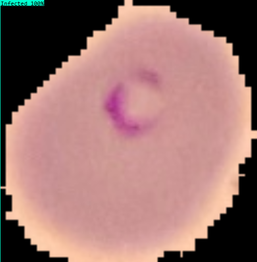
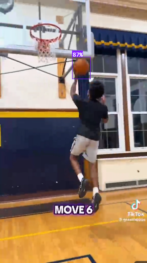
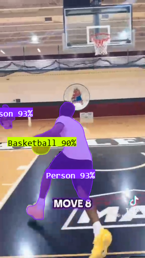
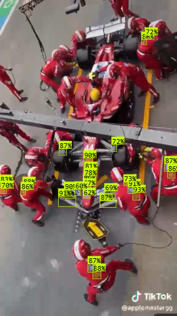

# Computer Vision Course Projects (NECA ICT, 2026)

Four computer vision projects I built during an in-person computer vision course at NECA ICT, Lagos (May to June 2026). Together they cover the three core vision tasks: **image classification, object detection and instance segmentation**.

Each project was done in class under a tutor's guidance, but the work on each was my own: preparing and labeling the data, choosing the model, training it and testing it in Roboflow. In the final assessment, I was the student who completed and trained a working model within the class time.

| Project | Task | Model | Training images | Result |
| --- | --- | --- | --- | --- |
| Malaria cell classification | Classification | ResNet18 | 91 | 100% validation accuracy |
| Basketball detection | Object detection | RF-DETR (Small) | 48 | 100% mAP50 |
| Player and ball segmentation | Instance segmentation | RF-DETR (Small) | 48 | 100% mAP50 |
| F1 pit stop logo detection (final assessment) | Object detection | YOLOv11 (Nano) | 64 | 86.3% mAP50, 87.6% precision, 89.3% recall |

**An honest note on the scores:** the perfect 100% scores come from very small test sets of only a few images, so they mostly show the model fit this data, not that it would hold up on new images. The final assessment score of 86.3% is the most realistic of the four. My larger, independent follow-up project, with a full review of every label, is [Egocentric Dishwashing Segmentation](https://github.com/MaryGit-24/egocentric-dishwashing-segmentation).

---

## 1. Malaria Cell Classification

Classifies single red blood cell images as infected or not infected with the malaria parasite.

- **Task:** single-label image classification
- **Model:** ResNet18, trained in Roboflow
- **Data:** 42 labeled cell images, expanded to 91 training images with augmentation
- **Result:** 100% validation accuracy; the example below is predicted "Infected" with 99.9% confidence

## 2. Basketball Detection

Draws a box around the basketball in frames from basketball videos.

- **Task:** object detection
- **Model:** Roboflow RF-DETR (Small)
- **Data:** 48 training images from basketball video frames
- **Result:** 100% mAP50, precision and recall on the test set

## 3. Player and Ball Segmentation

Outlines each player and the ball pixel by pixel, instead of only drawing boxes.

- **Task:** instance segmentation
- **Model:** Roboflow RF-DETR (Small)
- **Data:** 48 training images from basketball video frames
- **Result:** 100% mAP50; on the example below the model found the player (93%) and the basketball (90%)

## 4. F1 Pit Stop Logo Detection (Final Assessment)

Detects sponsor logos on Formula 1 pit crews and cars in fast, crowded pit stop footage.

- **Task:** object detection of many small objects
- **Model:** YOLOv11 (Nano), starting from COCO pretrained weights
- **Data:** 64 training images from pit stop video frames
- **Result:** 86.3% mAP50, 87.6% precision, 89.3% recall; 26 logos detected in the crowded example below

---

## What I learned

- How classification, detection and segmentation differ, and which one a problem needs
- Labeling data in Roboflow, and how much small datasets limit what a score can prove
- Training and testing modern models (ResNet, RF-DETR, YOLO) and reading mAP, precision and recall
- Small objects in busy scenes, like logos in a pit stop, are much harder than one large object

## Tools

Roboflow (labeling, training, testing), ResNet18, RF-DETR, YOLOv11.

## Author

Mary Imeabasi Udo, Data Scientist and AI Engineer, Lagos.
[Portfolio](https://marygit-24.github.io) · [LinkedIn](https://www.linkedin.com/in/udomary) · [GitHub](https://github.com/MaryGit-24)
